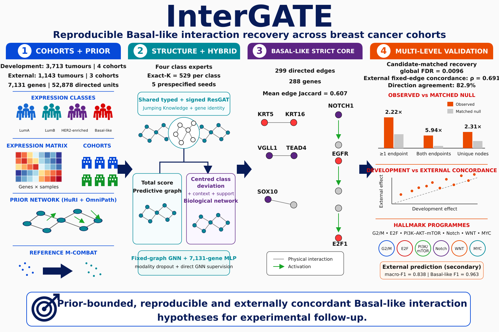
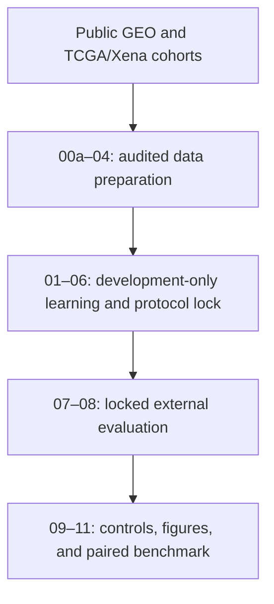

# InterGATE

<p align="center">
  <strong>Reproducible, biology-first sparse interactome learning for breast-cancer transcriptomics</strong>
</p>

<p align="center">
  
  
  
</p>

<p align="center">
  
</p>

InterGATE learns sparse, class-specific networks from a HuRI--OmniPath prior
while keeping prediction and biological network recovery as separate
estimands. The locked analysis uses 3,713 tumours from four development
cohorts, 1,143 tumours from three external cohorts, 7,131 connected genes,
52,878 eligible directed interactions, five prespecified seeds, and an equal
Exact-K = 529 budget for every class. The Basal-like strict 5/5 core contains
284 directed edges and 257 genes.

The repository reproduces the complete workflow reported in the manuscript:
public-data acquisition, audited endpoint construction, reference M-ComBat,
model fitting, stability and null analyses, protocol locking, external
evaluation, figures, and the paired tabular benchmark. InterGATE recovers
stable, class-contrastive interaction hypotheses within a declared prior.

> **Review status.** This repository is intentionally private during peer
> review. It is designed to be made public and archived as a versioned release
> upon acceptance.

## Start here

The supported environment is Python 3.11. From a clean clone:

```bash
git clone https://github.com/alex241278/InterGATE.git
cd InterGATE
mamba env create -f environment.yml
conda activate intergate
```

Then run data preparation first, followed by the numbered analyses:

```bash
python scripts/preflight.py --stage data
python scripts/run_pipeline.py data

python scripts/preflight.py --stage analysis
python scripts/run_pipeline.py analysis
```

The same sequence can be launched with one command:

```bash
python scripts/run_pipeline.py all
```

The runner executes notebooks without modifying their source files and stores
executed copies under `results/executed_notebooks/`. Use `--dry-run` to inspect
the exact order, and `--from-step` / `--through-step` to resume a bounded part:

```bash
python scripts/run_pipeline.py analysis --dry-run
python scripts/run_pipeline.py analysis --from-step 04 --through-step 06
```

A CUDA-capable GPU is strongly recommended for the five-seed InterGATE fit.
If a specific CUDA build is required, install PyTorch using the official
[PyTorch selector](https://pytorch.org/get-started/locally/) before running
`pip install -e ".[full]"`.

## Workflow



### Data preparation: run first

| Step | Notebook | Purpose |
|---:|---|---|
| 00a | `00a_download_microarrays.ipynb` | Download and audit five molecularly annotated microarray cohorts |
| 00b | `00b_download_rnaseq.ipynb` | Download and audit GSE96058 and TCGA-BRCA RNA-seq data |
| 01 | `01_union_datasets.ipynb` | Build the seven-cohort gene intersection and audit sample duplication |
| 02 | `02_preparacion_y_suelo.ipynb` | Enforce the intrinsic-four endpoint, correct the documented floor, and freeze the 4/3 cohort split |
| 03 | `03_split_y_mcombat_ref.ipynb` | Fit reference M-ComBat in development and project external cohorts separately |
| 04 | `04_qc_batch_y_fuga.ipynb` | Quantify residual technical structure and verify invariance |

Successful preparation creates the four immutable inputs consumed by the model:

```text
data_prepare/output_mcombat/
├── expr_train_mcombat.csv   # 11,145 genes × 3,713 development samples
├── expr_test_mcombat.csv    # 11,145 genes × 1,143 external samples
├── meta_train.csv
└── meta_test.csv
```

### Analysis: run in numerical order

| Step | Notebook | Main output |
|---:|---|---|
| 01 | `01_validar_runtime_y_evidencia.ipynb` | Connected prior and train-only differential-correlation evidence |
| 02 | `02_entrenar_INTERGATE_V6.ipynb` | Five complete seed bundles |
| 03 | `03_estabilidad_y_auditoria_V6.ipynb` | Multiseed reproducibility and consensus networks |
| 04 | `04_baselines_y_ablacion_minima.ipynb` | Development baselines, mechanistic controls, and definitive 0.075 score lock |
| 05 | `05_validacion_biologica_y_depmap.ipynb` | Candidate-matched nulls, topology-preserving rewiring, enrichment, and DepMap |
| 06 | `06_congelar_protocolo_externo.ipynb` | File hashes and external protocol lock |
| 07 | `07_test_externo_bloqueado.ipynb` | Single-use locked external predictive evaluation |
| 08 | `08_concordancia_estructural_externa.ipynb` | Post-lock external edge-effect concordance |
| 09 | `09_ablaciones_biologia_score_0075.ipynb` | Development-only biological-score ablations |
| 10 | `10_figuras_definitivas.ipynb` | Five manuscript figures in PDF, SVG, and PNG |
| 11 | `11_benchmark_tabular_pareado_S12.ipynb` | Paired tabular comparison and Supplementary Table 12 outputs |

Notebook 07 writes a completion marker and is not reopened by the runner after
a successful locked evaluation. Steps 08 and 11 use the already locked
protocol and never select a graph or hyperparameter from external performance.

## Two score coefficients, one unambiguous timeline

The training-stage biology score uses cohort-support weight **0.25**. After
model fitting, a development-only structural sensitivity analysis locks
**0.075** for the definitive biological networks, before the external block is
opened. The distinction is encoded in `configs/protocol_v6.json`, enforced in
`intergate/config.py`, and checked by the repository tests. No model is
retrained when the definitive 0.075 networks are reconstructed.

## Scientific scope

Prediction and biological network recovery are evaluated as distinct
objectives. The biological graphs are prior-bounded association hypotheses:
edge direction and regulatory sign remain annotations inherited from
HuRI--OmniPath, and differential correlation is not interpreted as a causal
effect. The paired external benchmark is predictive context, not a claim of
universal superiority.

## Licensed biological resources

MSigDB Hallmark and C2:CGP GMT files are downloaded by notebook 05. DepMap
files are not redistributed. To reproduce the DepMap analysis, place the
required release files as described in
[`resources_biological/README.md`](resources_biological/README.md). To run all
other biological analyses without DepMap, set:

```bash
export INTERGATE_RUN_DEPMAP=0
```

Skipping DepMap permits execution through analysis step 05 only; the full
paper protocol lock in step 06 intentionally requires the reported DepMap
outputs. For NCBI requests, the download notebook uses the corresponding author's
public contact by default. It can be overridden locally with
`INTERGATE_NCBI_EMAIL`.

## Repository map

```text
InterGATE/
├── data_prepare/           # public-data acquisition and reference M-ComBat
├── intergate/              # current V6 analysis package
├── notebooks/              # 11 source notebooks, clean and output-free
├── configs/                # machine-readable locked protocol
├── resources_biological/   # redistributable identifiers and resource guide
├── scripts/                # preflight and ordered notebook runner
├── tests/                  # protocol, inventory, and synthetic guards
└── assets/                 # graphical abstract
```

Generated data, model weights, caches, and results are deliberately excluded
from Git. Public source cohorts remain governed by their original repositories
and licences.

## Reproducibility checks

Run the complete static and synthetic audit with:

```bash
make test
```

The checks verify notebook order and cleanliness, portable paths, cohort and
seed contracts, Exact-\(K\), the 0.25-to-0.075 score timeline, and train-only
evidence invariance after an external block is appended.

## Citation and authorship

Citation metadata are available in [`CITATION.cff`](CITATION.cff). Laura
Senovilla and Alejandro Alvaro-Meca jointly supervised the work and share
senior authorship.

## Licence

Code, original documentation, and original graphics in this repository are
released under the [MIT License](LICENSE), unless a file states otherwise.
Third-party datasets and annotations retain their original terms.
