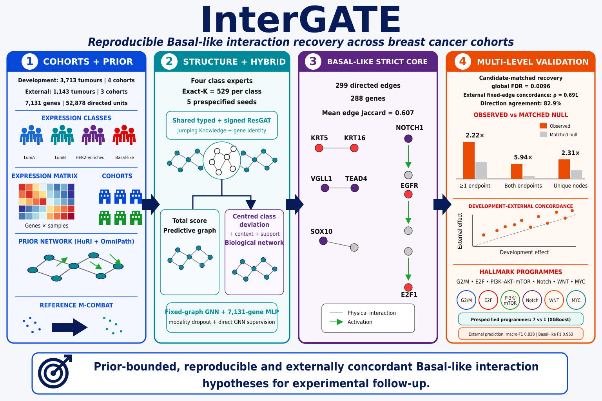
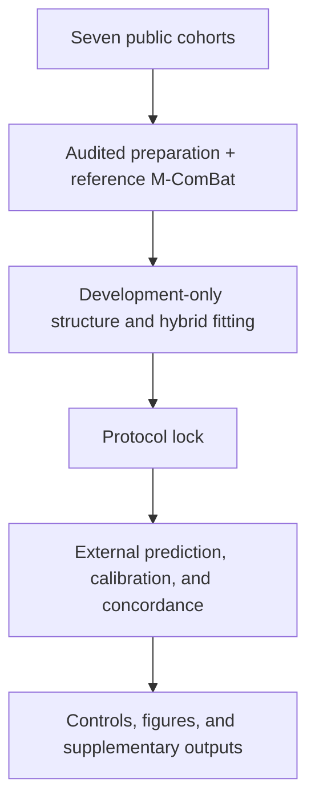

# InterGATE

<p align="center">
  <strong>A multi-cohort graph-learning framework for reproducible Basal-like interaction network recovery from breast cancer transcriptomes</strong>
</p>

<p align="center">
  
  
  
</p>

<p align="center">
  
</p>

InterGATE learns sparse, class-specific networks from a directed HuRI--OmniPath
prior while jointly preserving graph-derived and tabular predictive signal. The
study integrates 3,713 tumours from four development cohorts and 1,143 tumours
from three locked external cohorts. All models use the same 7,131 connected
genes, 52,878 eligible directed structural units, five prespecified seeds, and
an Exact-\(K=529\) edge budget for each subtype.

The recovered Basal-like strict 5/5 core contains **299 directed edges and 288
genes**, with mean pairwise edge Jaccard **0.607**. Its class-contrastive effects
generalize across the three external cohorts (meta-analytic Spearman
\(\rho=0.691\); directional agreement 82.9%). The external five-model ensemble
achieves macro-F1 **0.838** and Basal-like F1 **0.963**.

Complete Phase 1 and Phase 2 retraining across
\(\kappa\in\{0.005,0.007,0.010,0.015,0.020\}\) showed stable predictive
performance and positive graph/message-passing contributions throughout the
grid. The primary \(\kappa=0.010\) specification lies at the main
stability-to-size transition for the Basal-like network.

The repository reproduces the complete analysis: public-data acquisition,
audited endpoint construction, reference M-ComBat, structural meta-learning,
fixed-graph hybrid classification, multiseed recovery, candidate-matched and
topology-preserving nulls, atomic retraining ablations, full-retraining density
sensitivity, protocol locking, external evaluation, calibration, paired
tabular benchmarks, XGBoost--InterGATE programme recovery, and manuscript
figures.

## Quick start

The supported environment is Python 3.11:

```bash
git clone https://github.com/alex241278/InterGATE.git
cd InterGATE
mamba env create -f environment.yml
conda activate intergate
```

Prepare the public cohorts and run the analysis:

```bash
python scripts/preflight.py --stage data
python scripts/run_pipeline.py data

python scripts/preflight.py --stage analysis
python scripts/run_pipeline.py analysis
```

Use `--dry-run` to inspect the dependency-aware order and `--from-step` /
`--through-step` to resume a bounded interval:

```bash
python scripts/run_pipeline.py analysis --dry-run
python scripts/run_pipeline.py analysis --from-step 04 --through-step 06
```

A CUDA-capable GPU is strongly recommended for the five-seed fit and trained
ablations. Install the appropriate PyTorch build with the official
[PyTorch selector](https://pytorch.org/get-started/locally/) before
`pip install -e ".[full]"` when a platform-specific CUDA wheel is needed.

## Workflow



### Data preparation

| Step | Notebook | Purpose |
|---:|---|---|
| 00a | `00a_download_microarrays.ipynb` | Download and audit molecularly annotated microarray cohorts |
| 00b | `00b_download_rnaseq.ipynb` | Download and audit GSE96058 and TCGA-BRCA RNA-seq data |
| 01 | `01_union_datasets.ipynb` | Build the seven-cohort gene intersection and audit sample identity |
| 02 | `02_preparacion_y_suelo.ipynb` | Enforce the intrinsic-four endpoint and freeze the 4/3 cohort split |
| 03 | `03_split_y_mcombat_ref.ipynb` | Fit reference M-ComBat in development and project each external cohort separately |
| 04 | `04_qc_batch_y_fuga.ipynb` | Quantify residual technical structure and verify invariance |
| 05 | `05_supplementary_figure_mcombat_qc.ipynb` | Generate the supplementary harmonization figure |

Preparation creates the immutable matrices used downstream:

```text
data_prepare/output_mcombat/
├── expr_train_mcombat.csv   # 11,145 genes × 3,713 development samples
├── expr_test_mcombat.csv    # 11,145 genes × 1,143 external samples
├── meta_train.csv
└── meta_test.csv
```

### Analysis notebooks

The runner follows dependency order; figure notebooks run after all source
tables are available even when their historical numeric prefixes are lower.

| Order | Notebook | Main output |
|---:|---|---|
| 1 | `00_comprobar_instalacion.ipynb` | Environment and protocol contract |
| 2 | `01_validar_runtime_y_evidencia.ipynb` | Connected prior and train-only differential-correlation evidence |
| 3 | `02_entrenar_INTERGATE_V8.ipynb` | Five complete seed-specific model bundles |
| 4 | `03_estabilidad_y_auditoria_V8.ipynb` | Multiseed reproducibility and branch/message-passing reliance |
| 5 | `04_baselines_y_ablacion_minima.ipynb` | Development baselines, atomic retraining controls, and definitive 0.075 score lock |
| 6 | `05_validacion_biologica_y_depmap.ipynb` | Specificity, matched nulls, rewiring, enrichment, and DepMap |
| 7 | `06_congelar_protocolo_externo.ipynb` | Cryptographic protocol and artifact lock |
| 8 | `07_test_externo_bloqueado.ipynb` | Single-use locked external predictive evaluation |
| 9 | `07b_calibracion_posthoc.ipynb` | Development-fitted temperature calibration |
| 10 | `08a_benchmark_tabular_pareado_S12.ipynb` | Paired elastic-net, random-forest, and XGBoost benchmark |
| 11 | `08b_concordancia_estructural_externa.ipynb` | Fixed-edge external structural concordance |
| 12 | `08c_xgboost_vs_intergate_biology.ipynb` | Frozen XGBoost versus InterGATE Basal-like programme recovery |
| 13 | `09_ablaciones_biologia_score_0075.ipynb` | Definitive-score biological analysis of trained ablations |
| 14 | `12_controles_revision_q_permutaciones.ipynb` | Score/selector factorial, subset sensitivity, and optional label permutations |
| 15 | `12c_sensibilidad_kappa_con_reentrenamiento.ipynb` | Five-density Phase 1 + Phase 2 retraining sensitivity |
| 16 | `12d_generate_kappa_retraining_figure.ipynb` | Supplementary Figure S8 from the audited 12c source table |
| 17 | `10_figuras_definitivas.ipynb` | Main figures and complete-core supplementary network |
| 18 | `13_generate_supplementary_figures_S2_S3.ipynb` | Supplementary sensitivity figures |

The 49 full-retraining label permutations are intentionally opt-in because
they are computationally expensive. Run them with:

```bash
python scripts/run_pipeline.py analysis --from-step 12 --through-step 12 \
  --include-label-permutations
```

Without that flag, notebook 12 still reproduces the manuscript's factorial and
subset-sensitivity analyses and skips only the extended permutation block.
Notebook 12c is independent of the permutation block and can be resumed from
its per-seed completion contracts.

## Locked model contract

The machine-readable contract is
[`configs/protocol_v8.json`](configs/protocol_v8.json). Key invariants include:

- four expression-defined subtypes and a fixed 4-development/3-external split;
- 60 cohort-balanced structural meta-episodes per seed;
- 192 microbatches of size 2 and two optimizer updates per episode;
- `X_h = 0` throughout structural learning and cohort-deletion support;
- five graph-only epochs followed by at most 80 fixed-graph hybrid epochs;
- a full 7,131-gene tabular branch, trainable gene identity, expert deep
  supervision, tabular-branch dropout 0.30, and GNN auxiliary loss 0.50;
- 1,000 candidate-matched draws and 1,000 directed degree/type/sign-preserving
  rewirings for the primary biological validation.

The training-stage biological score uses cohort-support coefficient 0.25. A
development-only sensitivity analysis then fixes 0.075 for the definitive
biological networks without retraining the classifier. Predictive graphs use
the total structural score; biological association networks use centred class
deviation, train-only contextual agreement, and cohort-deletion support.

## Licensed resources

MSigDB Hallmark and C2:CGP GMT files are obtained by the biological-validation
workflow. DepMap files are not redistributed; place the corresponding release
files as described in
[`resources_biological/README.md`](resources_biological/README.md). All other
biological analyses can run with:

```bash
export INTERGATE_RUN_DEPMAP=0
```

## Repository map

```text
InterGATE/
├── data_prepare/           # acquisition, endpoint audit, and reference M-ComBat
├── intergate/              # model, training, validation, and figure modules
├── notebooks/              # clean, output-free source notebooks
├── configs/                # machine-readable protocol
├── resources_biological/   # identifiers and licensed-resource guide
├── scripts/                # preflight and dependency-aware runner
├── source_data/            # compact audited inputs for publication figures
├── tests/                  # protocol, notebook, and synthetic guards
├── docs/                   # execution and manuscript-code alignment
└── assets/                 # graphical abstract in SVG, PDF, and PNG
```

Generated matrices, model weights, caches, and results are excluded from Git.
The source cohorts remain governed by their original repositories and licences.

## Reproducibility audit

```bash
make test
```

The audit checks source syntax, notebook cleanliness and order, portable paths,
protocol constants, Exact-\(K\), the 0.25-to-0.075 score timeline, graphical
abstract values, and train-only evidence invariance.

The claim-to-code crosswalk is maintained in
[`docs/MANUSCRIPT_CODE_ALIGNMENT.md`](docs/MANUSCRIPT_CODE_ALIGNMENT.md).
The completed repository and publication-package checks are recorded in
[`docs/REPOSITORY_AUDIT.md`](docs/REPOSITORY_AUDIT.md).
The full-retraining density review and manuscript integration are recorded in
[`docs/AUDITORIA_12C_Y_ALINEACION.md`](docs/AUDITORIA_12C_Y_ALINEACION.md).

## Citation and licence

Citation metadata are available in [`CITATION.cff`](CITATION.cff). Code,
documentation, and original graphics are released under the
[MIT License](LICENSE); third-party datasets and annotations retain their own
terms.
